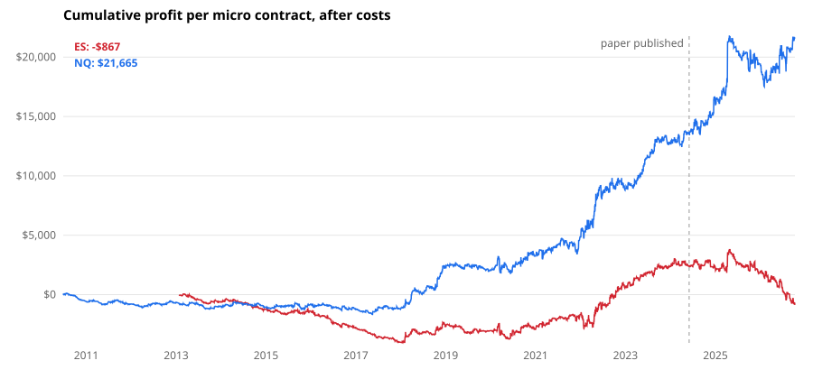

# Beat the Market: a replication on Nasdaq and S&P 500 futures

I replicated a published intraday momentum strategy on 16 years of 1-minute futures data to see whether it still works after costs, and after the paper came out.

**Paper:** Zarattini, C., Aziz, A. & Barbon, A. (2024). *Beat the Market: An Effective Intraday Momentum Strategy for S&P500 ETF (SPY).* [SSRN 4824172](https://papers.ssrn.com/sol3/papers.cfm?abstract_id=4824172).



## Result in one paragraph

On **Nasdaq-100 futures (NQ)** the strategy made money: +$21,665 per micro contract over 2010–2026 after costs, t-stat 2.74. But almost all of it came after 2018; from 2010 to 2017 it lost a little. On **S&P 500 futures (ES)** it made nothing (−$867, t-stat −0.20). After the paper was published (June 2024) NQ kept going up (+$13.90 per day), but 585 days is too short to call that significant (t-stat 1.37). So: a real-looking effect on NQ in the recent high-volatility regime, not a general law.

| | Days | Net per micro | Avg per day | t-stat | Winning days | Max drawdown |
|---|---|---|---|---|---|---|
| NQ, all (2010–2026) | 4,053 | $21,665 | $5.35 | 2.74 | 24% | −$4,250 |
| NQ, before publication | 3,468 | $13,535 | $3.90 | 2.59 | 24% | −$1,786 |
| NQ, after publication | 585 | $8,130 | $13.90 | 1.37 | 24% | −$4,250 |
| ES, all (2013–2026) | 3,410 | −$867 | −$0.25 | −0.20 | 24% | −$4,652 |
| ES, before publication | 2,825 | $2,387 | $0.84 | 0.69 | 24% | −$4,154 |
| ES, after publication | 585 | −$3,254 | −$5.56 | −1.21 | 23% | −$4,652 |

Year-by-year tables: [results/NQ_yearly.md](results/NQ_yearly.md) and [results/ES_yearly.md](results/ES_yearly.md).

## The rules (as in the paper, not tuned)

1. **Noise area.** For each minute of the day, take the average absolute move away from the open at that minute over the last 14 days. That gives a band around the open that widens during the day:
   - upper = max(open, yesterday's close) × (1 + σ)
   - lower = min(open, yesterday's close) × (1 − σ)
2. **Entry**, checked only every half hour from 10:00 to 15:30 New York time: close above the upper band → buy, below the lower band → sell short.
3. **Trailing stop**, also checked every half hour: a long position exits below max(upper band, VWAP), a short above min(lower band, VWAP).
4. **Flat at the close.** No overnight positions.

The idea: inside the band, price moves are noise. A move out of the band means real buying or selling pressure, which tends to continue for the rest of the day.

## How I tested it

- **Data:** 1-minute OHLCV bars of the continuous front-month NQ and ES futures from [Databento](https://databento.com/) (NQ from mid-2010, ES from 2013). Only regular trading hours (09:30–16:00 ET). Days with fewer than 380 of 390 bars (holidays, half days) are skipped.
- **No look-ahead:** the signal uses the close of the bar ending on the half hour, and the trade is filled at the **open of the next bar**.
- **Costs** per micro contract (MNQ $2/point, MES $5/point): $1.75 commission per round trip plus 1 tick (0.25 points) slippage on every fill.
- **Size:** always 1 contract. The paper scales position size with recent volatility. I kept it fixed so the dollar numbers are easy to read.
- **Tests:** `test_backtest.py` checks the rules on made-up days (quiet day = no trade, breakout = long until the close, pullback = trailing stop).

## What I take from it

- **Most days are small losses; a few big trend days pay for everything.** Only 24% of days are winners. That is typical for trend-following, and it makes the drawdowns long: −$4,250 per contract on NQ.
- **The edge depends on the market regime.** NQ in 2010–2017 had calm, mean-reverting days and the strategy lost slowly. Since 2018 Nasdaq has had many more strong trend days.
- **It did not survive on ES**, even though the paper was written on SPY (which tracks the same S&P 500 index). The paper covers a different period and uses volatility-based sizing, so this is not a contradiction of the paper, but it is a warning that the result is fragile.
- **A t-stat of 2.7 is not proof.** Before this one I tested many other strategies that did not work, so I should expect some false positives. This one was taken from the literature and not tuned, which helps, but the honest next step is to watch it forward in time, on paper, before risking money.

## Run it yourself

The market data is not included (Databento's license doesn't allow sharing it). Any 1-minute OHLCV file with a timestamp column and `open, high, low, close, volume` works.

```bash
pip install -r requirements.txt
python backtest.py data/NQ_1min.parquet --symbol NQ   # writes results/NQ_daily.csv and results/NQ_yearly.md
python backtest.py data/ES_1min.parquet --symbol ES
python chart.py                                        # writes results/equity.svg
python test_backtest.py
```

## Files

| File | What it does |
|---|---|
| `backtest.py` | Loads the bars, builds the noise area, simulates every day, writes the results |
| `chart.py` | Draws the cumulative profit chart as an SVG (no plotting library needed) |
| `test_backtest.py` | Checks the trading rules on small made-up examples |
| `results/` | Daily profit per contract and yearly tables for NQ and ES |

I wrote this with the help of an AI coding assistant (Claude). The choice of test, the checks and the conclusions are mine.

*This is a research project, not investment advice.*
